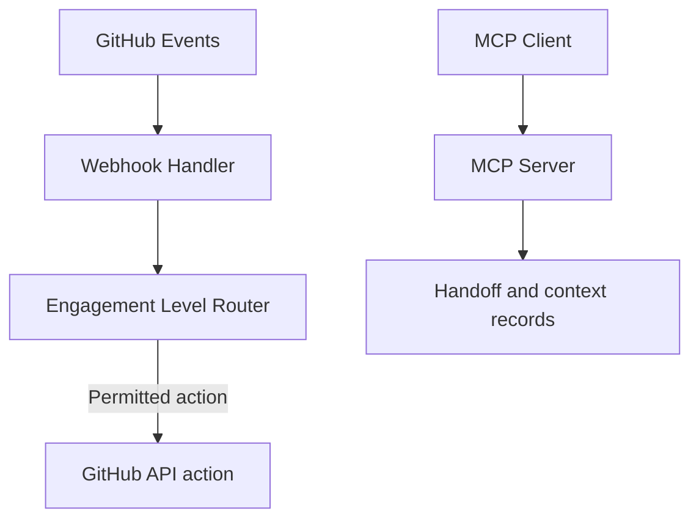

<div align="center">

# AgentCraftworks Community Edition

**The open protocol layer for agentic DevOps**

[](LICENSE)
[](https://nodejs.org)
[](https://www.typescriptlang.org)
[](https://modelcontextprotocol.io)

[Quick Start](#quick-start) · [How It Works](#how-it-works) · [Enterprise](#enterprise-edition) · [Docs](#documentation) · [Contribute](#contributing)

</div>

---

## The Problem

Agent workflows combine automation, AI tools, and human decisions. Their behavior depends on
the permissions, policies, and integrations configured around them; recording a request for work
does not, by itself, execute or dispatch that work.

## What AgentCraftworks Community Edition Does

AgentCraftworks Community Edition is a GitHub App and MCP server for agentic DevOps. It provides
a handoff state machine, the **Agent Engagement Levels** model, six MCP tools, and a reviewable
CODEOWNERS setup pull request on install. Pull-request routing uses labels today; CODEOWNERS
routing is being added in #266. The engagement model includes levels 1–5. **Levels 4–5 are
configurable; enforcement is in progress.**

> **What CE is / isn't**
>
> - **Is:** the MIT-licensed Community Edition, with the handoff state machine, engagement-level model, and six MCP tools documented in this repository.
> - **Isn't:** a prerequisite for Enterprise or a feature-trimmed Enterprise release. The editions serve different needs and have distinct capabilities.
>
> The full edition comparison is being drafted in [#243](https://github.com/AgentCraftworks/AgentCraftworks-CE/issues/243).

## SDLC Lifecycle Strategy

AgentCraftworks Community Edition supports teams across multiple SDLC phases, from brand-new product idea to production-ready governance.

- Prototype quickly with low policy friction
- Introduce staging and validation checks as solutions mature
- Enforce productized promotion flow (`feature/* -> staging -> main`)
- Operate production repos with explicit governance and incident-aware workflows

See `docs/SDLC_LIFECYCLE_STRATEGY.md` for the lifecycle model and phased policy/infrastructure guidance.

```
Pull Request / Push Event
         ↓
  AgentCraftworks Community Edition
         ↓
   Agent Engagement Levels (1–5)
    ├── Observer (T1):     Read, view, list
    ├── Advisor (T2):      Comment, suggest
    ├── Collaborator (T3): Label, assign, approve, edit file
    ├── Delegated (T4):    Merge, close, create branch, push commit
    └── Autonomous (T5):   Deploy, modify CI, orchestrate agents
         ↓
  CODEOWNERS Routing → Assigned Agent
         ↓
   MCP Tool Execution
         ↓
    GitHub Actions
```

## Key Features

| Feature | Description |
|---|---|
| **Agent Engagement Levels** | 5-level governance control (Observer → Autonomous) — set per-repo, per-team, per-event type |
| **MCP Interface** | Six tools create, accept, complete, and query handoffs, or attach and retrieve context. Creating a handoff records a request; it does not dispatch an agent. |
| **Finite State Machine** | Handoffs move through explicit states, with machine-readable failure reasons and inspectable history. A record does not verify that downstream work ran. |
| **CODEOWNERS Routing** | Events routed to the right agent based on ownership rules |
| **Webhook Handling** | Handles GitHub PR, push, issue, and workflow events |
| **GitHub App Scaffold** | Drop-in GitHub App: one install, works across all repos in your org |
| **Setup PR on Install** | Installing the App opens a reviewable CODEOWNERS pull request — no silent repository changes |
| **Edition comparison** | See the comparison being drafted in [#243](https://github.com/AgentCraftworks/AgentCraftworks-CE/issues/243). |

## Architecture



## Quick Start

There are two ways to get started, depending on whether you want to **use** AgentCraftworks CE or **run your own instance**.

### Track 1 — Install the GitHub App (fastest)

1. Install the AgentCraftworks CE GitHub App on your organisation or repository.
2. CE opens a **setup pull request** adding a default `.github/CODEOWNERS` — this is the routing layer that decides which agents and humans review which paths.
3. Review and customise the routing patterns, replacing the placeholder team handles with your real GitHub teams.
4. Merge the PR to activate agent routing.

Nothing is changed in your repository without a human merging that PR.

### Track 2 — Run your own instance

```bash
# Requirements: Node.js 22+, GitHub App credentials
git clone https://github.com/AgentCraftworks/AgentCraftworks-CE.git
cd AgentCraftworks-CE/typescript
npm install

# Configure environment
cp ../.env.example ../.env
# Add your GitHub App credentials — see DEPLOYMENT.md for how to create the App

# Load environment variables (the service reads from the process environment, not .env automatically)
set -a && source ../.env && set +a

# Build and start
npm run build
npm start
```

Full instructions, including Docker Compose and Azure deployment, are in **[DEPLOYMENT.md](DEPLOYMENT.md)**.

**Webhook endpoint:** `POST /api/webhook`  
**Health check:** `GET /health`  
**MCP tools:** `GET /mcp/tools`

## How It Works

### 1. Agent Engagement Levels
Every repo gets an engagement level (1–5). The level determines what the agent is permitted to do:

| Level | Name | Action Tier | Permitted Actions |
|-------|------|-------------|-------------------|
| 1 | Observer | T1 | Read, view, list |
| 2 | Advisor | T2 | Comment, suggest |
| 3 | Collaborator | T3 | Label, assign, approve, edit file |
| 4 | Delegated | T4 | Merge, close, create branch, push commit |
| 5 | Autonomous | T5 | Deploy, modify CI, orchestrate agents |

Environment caps: local=5, dev=5, staging=4, production=3

### 2. Handoff Finite State Machine
Every agent handoff follows a deterministic state machine:

```
pending ──→ active ──→ completed
   │           │
   └─────→ failed ←────┘
```

Four states, two terminal (`completed`, `failed`). A `failed` handoff always carries a
reason prefix — `rejected:`, `abandoned:`, `error:` or `timeout:` — so the cause is
machine-readable. `overdue` is a **computed property**, not a stored state.

The state machine makes handoff status and failure reasons explicit. It does not by itself prove
that a receiving agent executed the work or provide Enterprise compliance evidence.

### 3. MCP-Compatible
AgentCraftworks Community Edition ships a Model Context Protocol (MCP) server. An MCP-capable
client can connect and use these six tools. The tools manage handoff and context records; they do
not dispatch agents:

| Tool | Description |
|---|---|
| `create_handoff` | Create a new agent handoff |
| `accept_handoff` | Accept a pending handoff |
| `complete_handoff` | Mark a handoff as completed |
| `query_workflow_state` | Query handoff state and history |
| `attach_context` | Attach structured context to a handoff |
| `get_context` | Retrieve context for a handoff |

## Enterprise Edition

[AgentCraftworks Enterprise](https://agentcraftworks.com) adds organization-wide policy,
multi-instance services, and integrations for larger deployments.

| Enterprise capability | Scope |
|---|---|
| Organization-wide policy and centralized ceilings | Apply policy across repositories and teams |
| Durable multi-replica state | Share state across service instances |
| Promotion Engine | Coordinate staged production promotion |
| Compliance evidence | Provide organization-level evidence and reporting |
| Multi-squad S2S coordination | Coordinate multiple squads across services |
| Distributed Rate Governor | Enforce budgets across instances |
| Aspire integration | Integrate distributed tracing and health checks |
| Quarantine Bridge | Integrate organization-level abuse response |
| Entra ID | Provide enterprise identity integration |

The edition comparison is being drafted in [#243](https://github.com/AgentCraftworks/AgentCraftworks-CE/issues/243).

## Fork & Customize

AgentCraftworks CE is MIT-licensed — you can fork it and run your own instance, with or without rebranding.

- **Keep the name?** You still need your own GitHub App credentials, Azure subscription, and CODEOWNERS teams.
- **Rename it?** The MIT license requires preserving the copyright notice, but you're free to rebrand everything else.

See the **[Fork & Rename Guide](FORKING.md)** for the workflows to disable on a fork.

## Documentation

- [Quick Start](#quick-start)
- [Deployment Guide](DEPLOYMENT.md)
- [Fork & Rename Guide](FORKING.md)
- [Agent Engagement Levels Reference](docs/architecture.md#agent-engagement-levels-reference)
- [MCP Tool Reference](#3-mcp-compatible)
- [Architecture Overview](docs/architecture.md)
- [SDLC Lifecycle Strategy](docs/SDLC_LIFECYCLE_STRATEGY.md)
- [Accessibility Capability](docs/accessibility.md)
- [Contributing Guide](CONTRIBUTING.md)

## Contributing

We welcome contributions! Please read our [Contributing Guide](CONTRIBUTING.md) first — all contributors must sign our [CLA](.github/CLA.md).

```bash
# Run tests
cd typescript && npm test

# Lint
npm run lint
```

## License

MIT License — Copyright (c) 2025 AgentCraftworks

See [LICENSE](LICENSE) for full text.

---

<div align="center">

Built with ❤️ for the agentic DevOps era · Powered by Azure + GitHub Copilot

[Enterprise](https://agentcraftworks.com) · [Issues](https://github.com/AgentCraftworks/AgentCraftworks-CE/issues) · [Discussions](https://github.com/AgentCraftworks/AgentCraftworks-CE/discussions)

</div>
