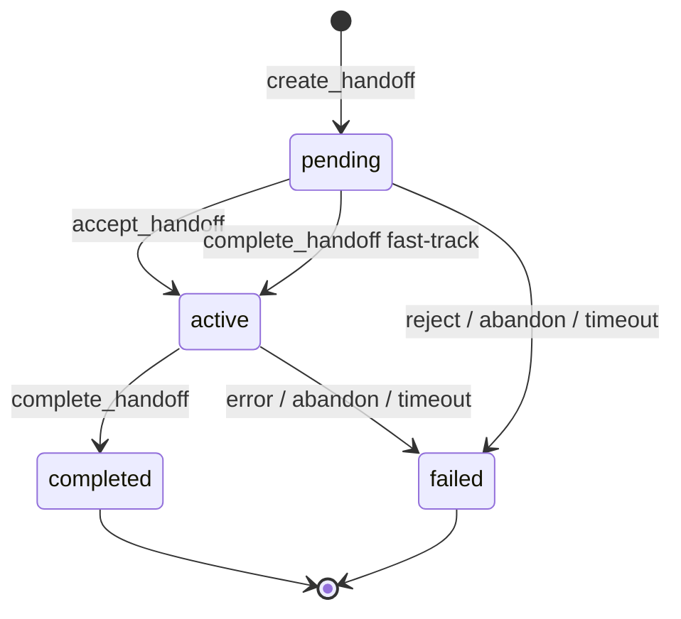

# Handoff Lifecycle

> **Status:** DRAFT · **Edition:** Community · **Last updated:** 2026-11-07

Community Edition represents a handoff as a four-state record. Creating the record does not
dispatch an agent or prove that the requested work ran.

| State | Meaning | Terminal |
|---|---|---:|
| `pending` | Handoff record created; not yet accepted | No |
| `active` | Handoff accepted or marked in progress | No |
| `completed` | Handoff marked complete | Yes |
| `failed` | Handoff could not continue | Yes |

## Allowed transitions

- `pending` → `active` when accepted.
- `pending` → `failed` when rejected, abandoned, or timed out.
- `active` → `completed` when marked complete.
- `active` → `failed` on an error, abandonment, or timeout.
- `completed` and `failed` are terminal; neither has a next state.

The `complete_handoff` MCP tool can complete a still-pending record by first moving it to
`active`, then to `completed`. It does not execute the task.

## Failure reasons

Failed handoffs use reason prefixes to make the failure category explicit:

| Prefix | Typical cause |
|---|---|
| `rejected:` | A receiving agent declined the work |
| `abandoned:` | Work was cancelled or the associated pull request closed |
| `error:` | A processing or system error occurred |
| `timeout:` | An SLA or other timeout was reached |

For example, `abandoned:PR closed` records an abandoned handoff. There is no separate
`rejected` or `abandoned` state.

## SLA and overdue status

`overdue` is computed from an SLA deadline and a non-terminal handoff state. It is not a
stored state and does not add another transition to the state machine.

## Storage and related tools

The current TypeScript implementation stores handoffs in memory, so a process restart loses
the records. The MCP server exposes `create_handoff`, `accept_handoff`,
`complete_handoff`, and `query_workflow_state` for lifecycle records. See
[MCP Tools](MCP_TOOLS.md) for all six tools, including context operations.
