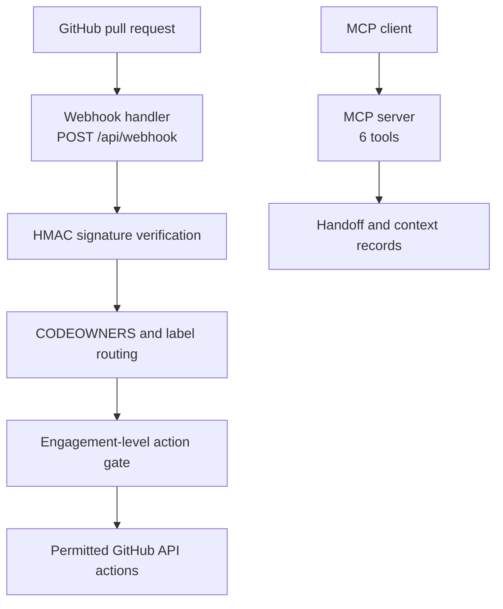
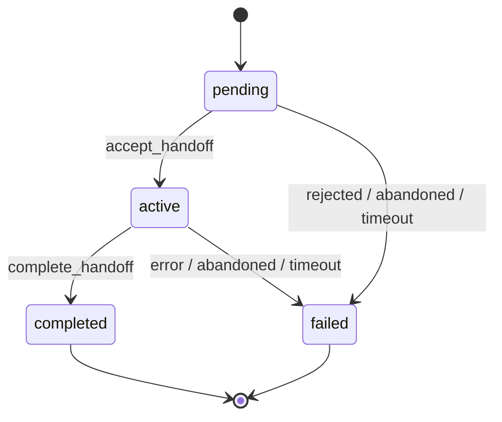

# AgentCraftworks Community Edition Architecture

This document describes Community Edition's webhook routing, governance checks, and handoff records.

## SDLC Lifecycle Context

Architecture decisions in this repository align to a staged SDLC strategy:

- Greenfield ideation and rapid prototyping
- Validation and staging hardening
- Productized promotion flow and governance
- Production operations and incident response

See [SDLC Lifecycle Strategy](SDLC_LIFECYCLE_STRATEGY.md) for the lifecycle model and when to activate stricter repo policy and infrastructure controls.

## Community Edition Architecture

The MCP tools create and manage handoff and context records; they do not dispatch agents or
prove that requested work was executed. Levels 4–5 can be configured but are not yet enforced
on all job paths.

## Handoff State Machine

Every agent handoff is a transition in a 4-state machine with two terminal states:

- Handoff IDs are UUIDs.
- `failed` always carries a reason prefix: `rejected:`, `abandoned:`, `error:` or `timeout:`.
- `overdue` is a **computed property**, not a stored state.

## MCP Tool Reference

| Tool | Description |
|---|---|
| `create_handoff` | Create a new agent handoff |
| `accept_handoff` | Accept a pending handoff |
| `complete_handoff` | Mark a handoff as completed |
| `query_workflow_state` | Query handoff state and history |
| `attach_context` | Attach structured context to a handoff |
| `get_context` | Retrieve context for a handoff |

## Agent Engagement Levels Reference

| Level | Name | Action Tier | Permitted Actions | Human Required |
|---|---|---|---|---|
| 1 | Observer | T1 | Read, view, list | Always |
| 2 | Advisor | T2 | Comment, suggest | Always |
| 3 | Collaborator | T3 | Label, assign, approve, edit file | For merge |
| 4 | Delegated | T4 | Actions subject to operator and repository policy | Enforcement in progress |
| 5 | Autonomous | T5 | Actions subject to operator and repository policy | Enforcement in progress |

Environment caps default to local=5, dev=5, staging=4, production=3. Protected actions are
denied by default and require both repository and operator allow-lists.